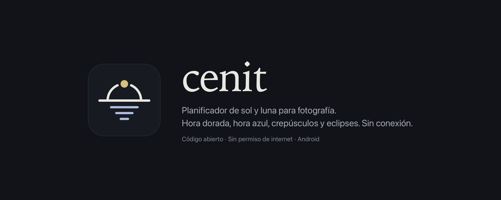
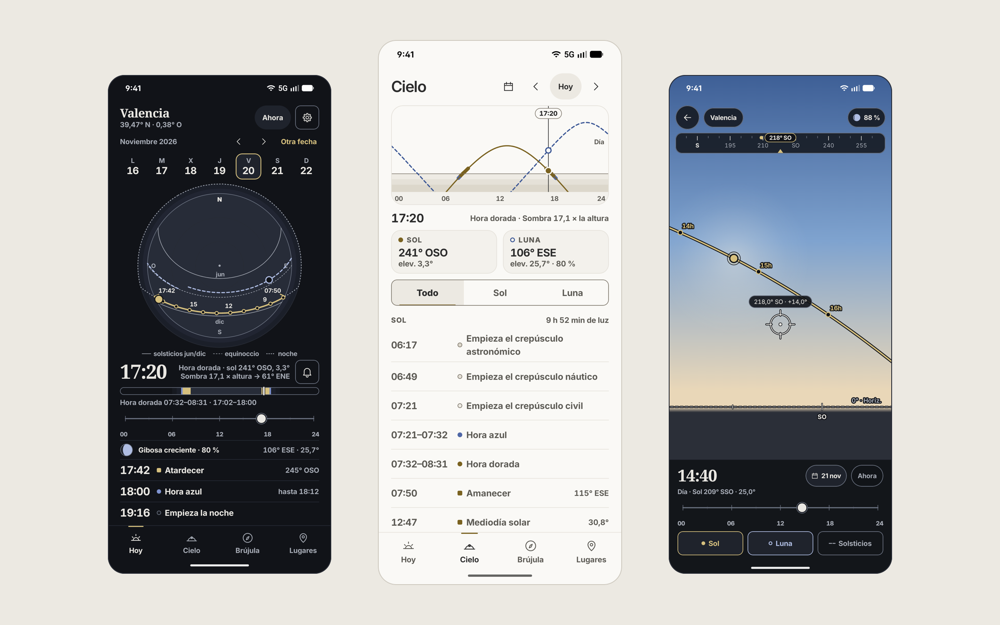
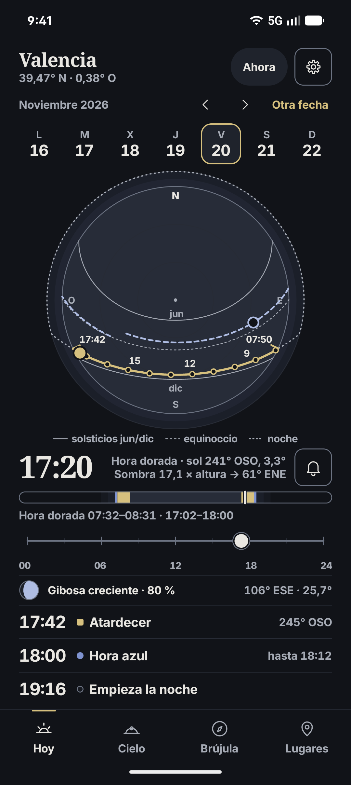
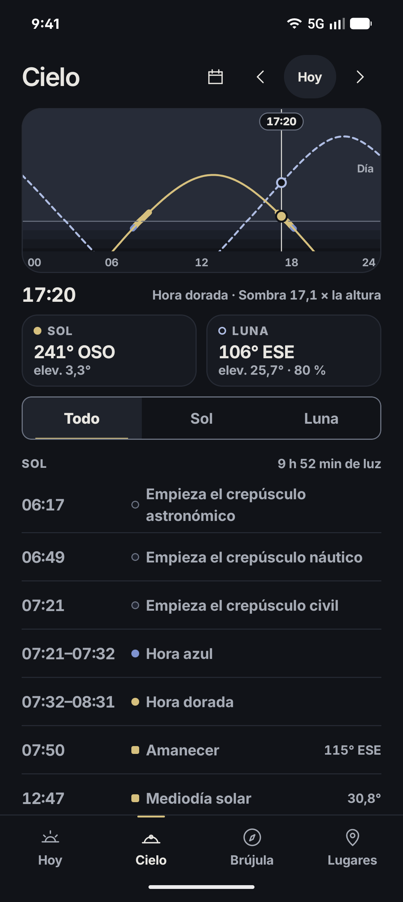
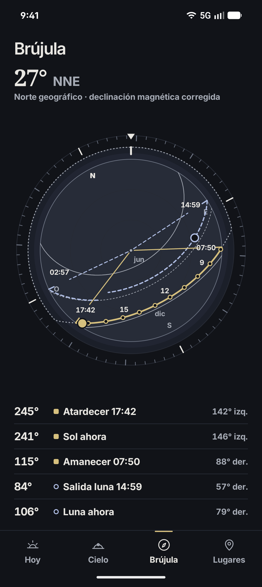
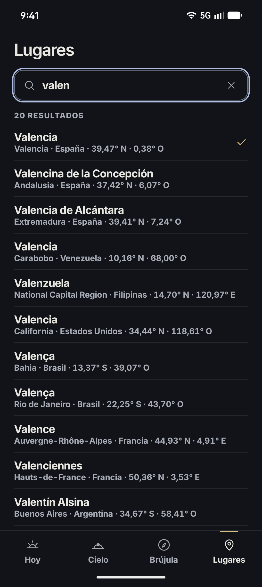
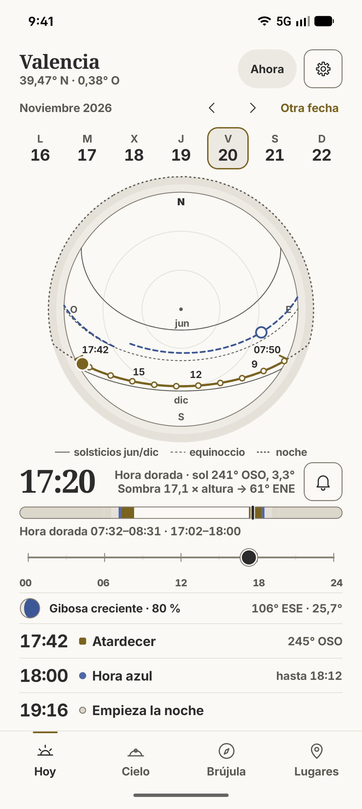
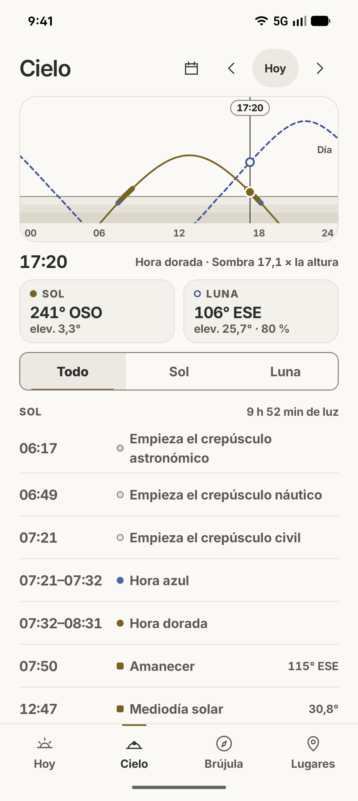
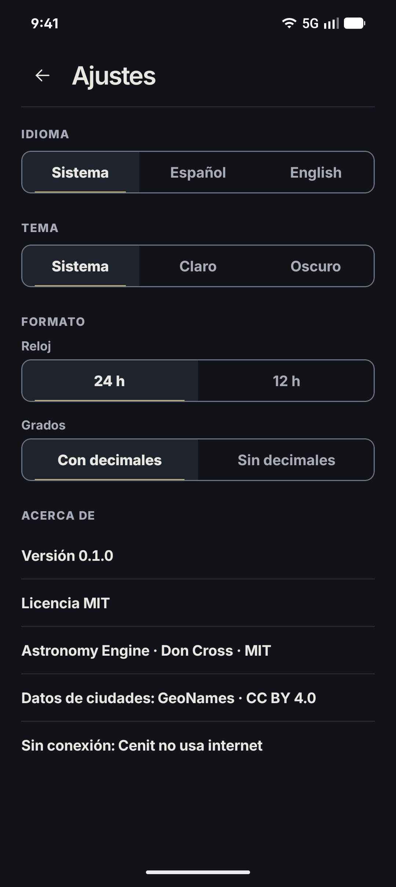

<p align="center"></p>

<p align="center"><a href="README.md">English</a> · <strong>Español</strong></p>

# Cenit

Aplicación Android de código abierto para planificar la luz del sol y la luna sin conexión.

<p align="center"></p>

## Instalación

Cenit necesita Android 10 o superior (`minSdk 29`).

1. Descarga `cenit-<versión>.apk` desde [GitHub Releases](https://github.com/Ivan-olivera-dev/cenit/releases/latest), o sigue este repositorio con [Obtainium](https://github.com/ImranR98/Obtainium) para recibir las actualizaciones automáticamente.
2. Abre el APK en el móvil y acepta instalar aplicaciones desde esa fuente cuando Android te lo pida.

Cada versión incluye un archivo `.sha256` y una atestación SLSA de procedencia (consulta [Privacidad y verificación](#privacidad-y-verificación)).

## Capturas

| Hoy | Cielo | Brújula | Lugares |
| :---: | :---: | :---: | :---: |
|  |  |  |  |

| Hoy (claro) | Cielo (claro) | Ajustes |
| :---: | :---: | :---: |
|  |  |  |

*Capturas reales en un móvil, situadas en Valencia a las 17:20 durante la hora dorada.*

## Qué hace Cenit

- Cúpula plana con el recorrido del sol hora a hora, tramo nocturno, trayectorias de los solsticios de junio y diciembre, equinoccio y recorrido de la luna. Puedes moverte por el día con el deslizador o elegir cualquier fecha en el calendario.
- Horarios solares y gráfica de elevación: amanecer, atardecer, mediodía solar, hora dorada (−4° a +6°), hora azul (−6° a −4°) y crepúsculos civil, náutico y astronómico.
- Datos lunares: salida y puesta de la luna, fase, porcentaje de iluminación y próximos cuartos.
- Próximos eclipses de sol y de luna visibles desde el lugar activo.
- Longitud relativa de la sombra respecto a la altura del objeto y rumbo hacia el que cae.
- Brújula en tiempo real con el magnetómetro, corregida al norte geográfico mediante declinación magnética, con los rumbos de salida y puesta.
- Ubicación sin red: búsqueda sin conexión entre 69.440 localidades de GeoNames (población igual o superior a 5.000 habitantes), GPS mediante `LocationManager`, coordenadas manuales y lugares guardados.
- Avisos locales programados entre 30 y 40 minutos antes de la hora dorada, la hora azul, el amanecer, el atardecer o los crepúsculos.
- Interfaz en español e inglés, tema claro y oscuro, reloj de 24 h o 12 h y grados con o sin decimales.

Cenit se inspira en Sun Seeker. Es una aplicación independiente de código abierto, sin relación con ozPDA.

## Precisión

Todas las efemérides se calculan en el propio teléfono con [Astronomy Engine](https://github.com/cosinekitty/astronomy) (v2.1.19 vendorizada en `:astronomy`).

Los tests de `:core` comprueban los horarios del sol, la luna, las estaciones y los eclipses frente a tablas publicadas de timeanddate.com, USNO y NASA GSFC. Por ejemplo, en Madrid (40,4165° N, 3,7026° O) el 21 de junio de 2026 amanece a las 06:44 y atardece a las 21:48. Las horas se muestran truncadas al minuto, igual que en timeanddate.com.

## Privacidad y verificación

### Sin permiso de internet

Cenit no declara `android.permission.INTERNET` en [`app/src/main/AndroidManifest.xml`](app/src/main/AndroidManifest.xml), así que Android impide al proceso abrir conexiones de red. Los lugares guardados y las coordenadas se quedan en el móvil y las copias de seguridad en la nube están desactivadas (`allowBackup="false"`).

Puedes comprobar los permisos de cualquier APK con:

```bash
aapt2 dump permissions cenit-<versión>.apk
```

Aparecen `ACCESS_COARSE_LOCATION` y `ACCESS_FINE_LOCATION` (GPS, solo cuando tocas *Mi ubicación*), `CAMERA` (vista de cámara en directo, solo cuando la abres; las imágenes nunca salen del teléfono y no se graba ni se guarda nada), `POST_NOTIFICATIONS` y `RECEIVE_BOOT_COMPLETED` (avisos), y además `io.github.ivan_olivera_dev.cenit.DYNAMIC_RECEIVER_NOT_EXPORTED_PERMISSION`, que añade AndroidX para que solo la propia Cenit pueda enviar mensajes a sus receptores.

### Compilación sin firmar reproducible

[`app/build.gradle.kts`](app/build.gradle.kts) activa `isPreserveFileTimestamps = false` e `isReproducibleFileOrder = true`, y omite el bloque cifrado `dependenciesInfo` de Google. Si compilas la misma etiqueta con JDK 21 y los mismos valores de `versionName` y `versionCode` que la CI, el APK sin firmar coincide en código y recursos con la versión publicada:

```bash
git clone https://github.com/Ivan-olivera-dev/cenit.git
cd cenit
git checkout v<versión>
# Consulta el versionCode del APK publicado: aapt2 dump badging cenit-<versión>.apk | head -1
./gradlew :app:assembleRelease -PversionName=<versión> -PversionCode=<versionCode>
```

El APK publicado lleva la firma de lanzamiento, por lo que su hash completo difiere del archivo sin firmar; puedes comparar el contenido con `diffoscope`.

### Suma SHA-256 y atestación SLSA

GitHub Actions compila y firma cada versión mediante [`.github/workflows/android-ci-release.yml`](.github/workflows/android-ci-release.yml) cuando se empuja una etiqueta `v*`. Puedes verificar un APK descargado con su suma SHA-256 y su atestación de procedencia:

```bash
sha256sum -c cenit-<versión>.apk.sha256
gh attestation verify cenit-<versión>.apk --owner Ivan-olivera-dev
```

## Diseño

El tema claro parte del papel cálido de Scrolless y el oscuro de la tinta de Sereno, con ocre solar y azul lunar como acentos, tipografías del sistema (sans y una serif para las cifras principales) y sin sombras.

| Token | Claro | Oscuro | Uso |
| :--- | :--- | :--- | :--- |
| `bgColor` | `#FAF9F6` | `#111318` | Fondo de pantalla |
| `surfaceColor` | `#F3F1EC` | `#171A21` | Paneles, gráfica y hojas |
| `textPrimary` | `#2C2C2C` | `#E9E7E2` | Títulos, horas y valores principales |
| `textSecondary` | `#5C5A54` | `#A6ABB5` | Etiquetas, pies y acimutes |
| `sun` | `#7A6220` | `#D6C07E` | Trayectoria solar, hora dorada y estado activo |
| `moon` | `#3D5896` | `#AFBDE3` | Trayectoria lunar y horas de la luna |

La lista completa de tokens y las comprobaciones de contraste WCAG están en [`design/system.md`](design/system.md). Los bocetos HTML están en [`design/`](design/), incluido el diseño elegido [`design/cenit-stage-1/02-cupula.html`](design/cenit-stage-1/02-cupula.html). Las imágenes de marca de [`docs/brand/`](docs/brand/) se generan con `node tools/brand/render.mjs`.

## Estructura del proyecto

- `core/` (`:core`): efemérides en Kotlin puro, proyección de la cúpula, datos de la gráfica de elevación, matemáticas de la brújula, búsqueda de eclipses, índice de ciudades, programación de avisos y formato de horas.
- `app/` (`:app`): pantallas en Jetpack Compose, lectura del magnetómetro y `LocationManager`, persistencia local en JSON, notificaciones y ajustes.
- `third_party/astronomy/` (`:astronomy`): fuente sin modificar de Astronomy Engine v2.1.19 con comprobación SHA-256 (`verifyVendoredSource`).
- `tools/geonames/`: generador en Python y tests unitarios para la lista local de ciudades.
- `tools/brand/`: plantillas SVG/HTML y script de renderizado en macOS para `docs/brand/`.
- `scripts/`: `check-manifest.sh` (comprueba que no haya permiso `INTERNET` y que las copias estén desactivadas) y `test-check-manifest.sh`.
- `design/`: sistema de diseño y bocetos HTML.

## Compilación

Necesitas el Android SDK. Gradle descarga JDK 21 automáticamente según `gradle/gradle-daemon-jvm.properties`, o utiliza antes un JDK 21 instalado en el equipo.

```bash
./gradlew :core:test :app:testDebugUnitTest :app:assembleDebug
scripts/check-manifest.sh app/build/outputs/apk/debug/app-debug.apk
scripts/test-check-manifest.sh
python3 -IB -m unittest discover -s tools/geonames -p 'test_*.py'
```

Puntos de confianza de la compilación: `distributionSha256Sum` fija el wrapper de Gradle en `gradle/wrapper/gradle-wrapper.properties`. El JDK 21 que se descarga desde las URL de foojay en `gradle/gradle-daemon-jvm.properties` viaja por HTTPS sin checksum; instala un JDK 21 local si quieres evitar esa descarga. Ninguno de los dos pasos afecta al APK generado.

### Compilación de release y firma

```bash
./gradlew :app:assembleRelease
```

Sin propiedades de firma genera `app/build/outputs/apk/release/app-release-unsigned.apk` (minificado, unos 5,9 MB).

Para firmar una release en local, guarda la clave fuera del repositorio y define cuatro propiedades en `~/.gradle/gradle.properties`:

```properties
cenitReleaseStoreFile=/Users/tu-usuario/.android/cenit-release.jks
cenitReleaseStorePassword=...
cenitReleaseKeyAlias=cenit
cenitReleaseKeyPassword=...
```

Crea el almacén de claves una vez y guarda una copia de seguridad fuera del equipo (si lo pierdes, las instalaciones existentes no podrán actualizarse):

```bash
keytool -genkeypair -keystore ~/.android/cenit-release.jks -alias cenit -keyalg RSA -keysize 4096 -validity 36500
```

Para probar una build minificada sobre una instalación de depuración sin perder sus datos, fírmala con la clave de debug:

```bash
./gradlew :app:assembleRelease -PcenitReleaseDebugSigning=true
```

## Publicar versiones

El proceso está en [`RELEASING.md`](RELEASING.md). Al empujar una etiqueta `v*`, GitHub Actions ejecuta los tests, verifica el manifiesto, firma el APK, adjunta su `.sha256` y genera la atestación SLSA.

## Créditos y licencias

- [Astronomy Engine](https://github.com/cosinekitty/astronomy) v2.1.19, de Don Cross, licencia MIT, vendorizada sin cambios en [`third_party/astronomy/`](third_party/astronomy/) (procedencia y hashes en [`third_party/astronomy/README.md`](third_party/astronomy/README.md)).
- Datos de ciudades de [GeoNames](https://www.geonames.org/), licencia CC BY 4.0, incluidos en [`app/src/main/assets/geonames/cities.tsv`](app/src/main/assets/geonames/cities.tsv) (69.440 localidades con población igual o superior a 5.000 habitantes, descargados el 2026-11-20; se regenera con `python3 -I tools/geonames/build_cities.py`).

## Licencia

Cenit se distribuye bajo la licencia [MIT](LICENSE).
