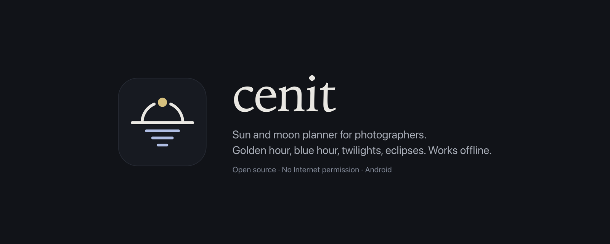
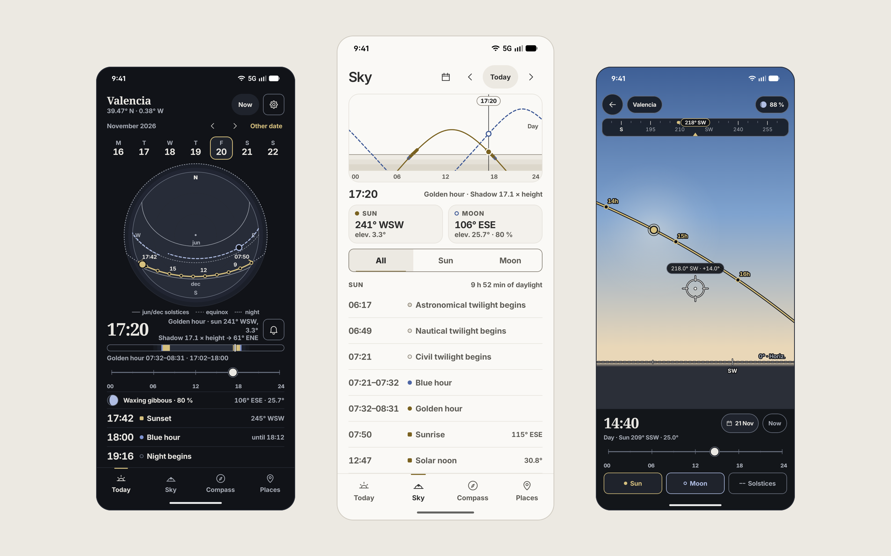
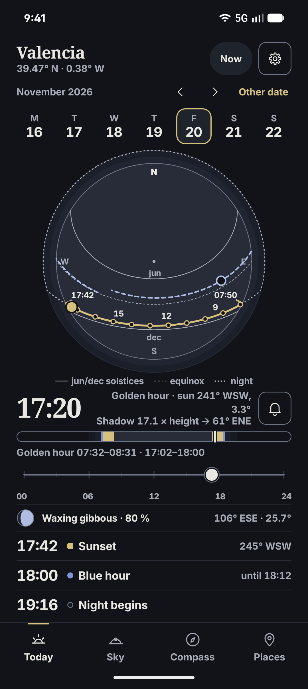
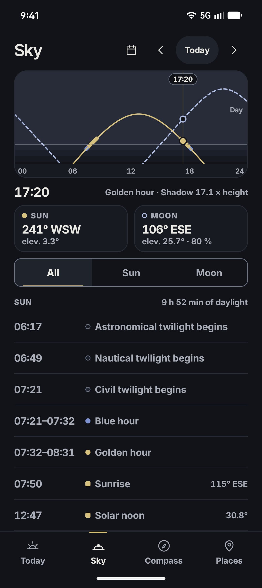
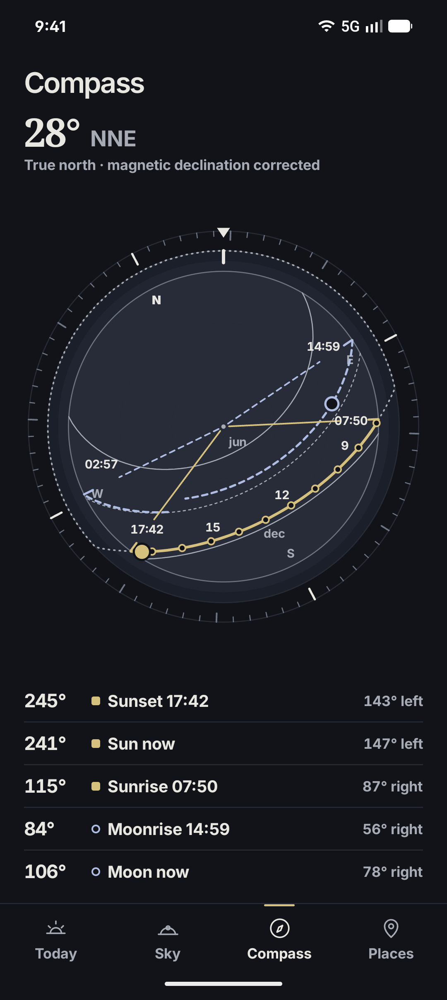
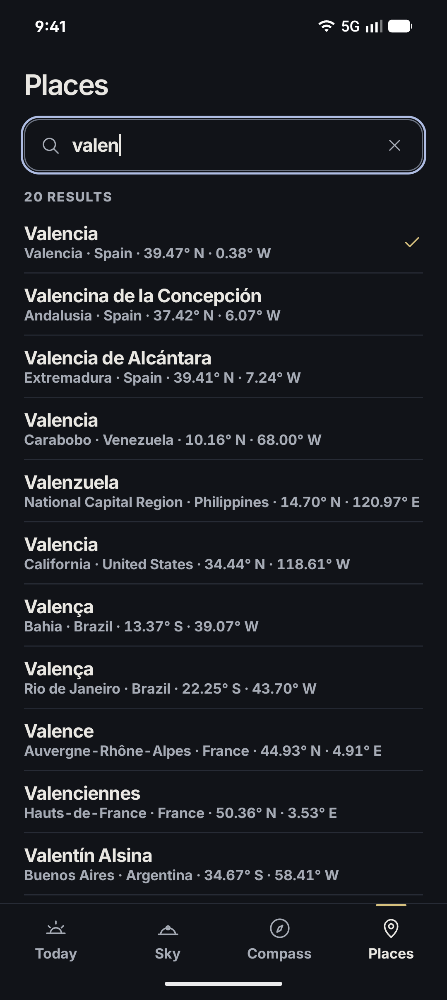
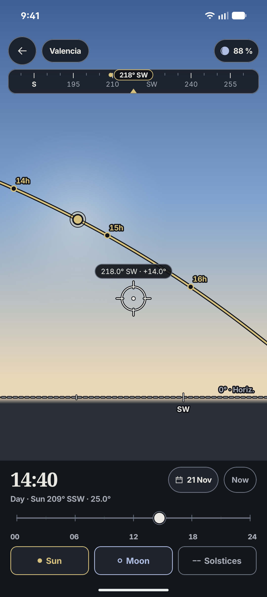
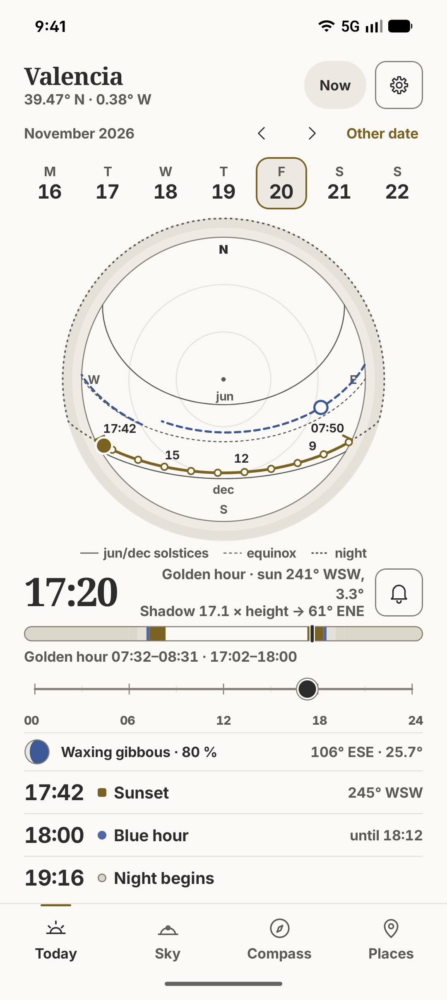
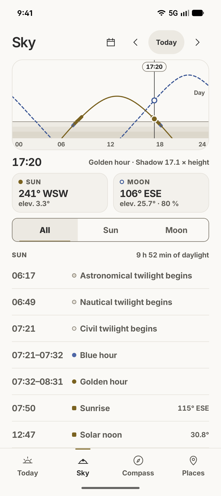
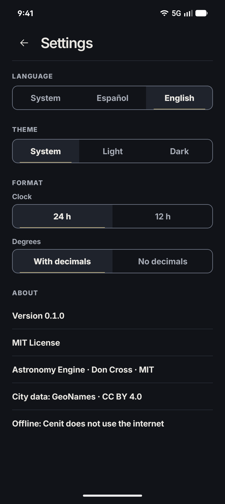

<p align="center"></p>

<p align="center"><strong>English</strong> · <a href="README.es.md">Español</a></p>

# Cenit

Open-source Android app for planning sun and moon light, built to work offline.

<p align="center"></p>

## Installation

Cenit requires Android 10 or later (`minSdk 29`).

1. Download `cenit-<version>.apk` from [GitHub Releases](https://github.com/Ivan-olivera-dev/cenit/releases/latest), or track this repository in [Obtainium](https://github.com/ImranR98/Obtainium) for automatic updates.
2. Open the APK on your phone and allow installation from that source when Android asks.

Each release includes a `.sha256` checksum and a GitHub SLSA build provenance attestation (see [Privacy and verification](#privacy-and-verification)).

## Screenshots

| Today | Sky | Compass | Places |
| :---: | :---: | :---: | :---: |
|  |  |  |  |

| Camera | Today (light) | Sky (light) | Settings |
| :---: | :---: | :---: | :---: |
|  |  |  |  |

*Real phone screenshots in Valencia, at 17:20 during golden hour and at 14:40 in the camera view. In the camera screenshot the live camera image is replaced by a drawn sky and the phone's orientation is fixed; everything on top of it is the app as it runs.*

## What Cenit does

- Flat compass dome with the day's sun path, hourly dots, night path, June and December solstice paths, equinox path and moon path. Scrub through the day with the time slider or jump to any date in the calendar.
- Solar times and elevation chart: sunrise, sunset, solar noon, golden hour (−4° to +6°), blue hour (−6° to −4°), and civil, nautical and astronomical twilight.
- Moon times and phase: moonrise, moonset, illumination percentage, phase name and upcoming lunar quarters.
- Next solar and lunar eclipses visible from the active place.
- Shadow length ratio relative to object height and the compass direction the shadow falls.
- Live compass with magnetometer heading corrected to true north via magnetic declination, plus rise and set azimuth rays.
- Offline location tools: search 69,440 bundled GeoNames places (population 5,000 or more), read GPS from Android's `LocationManager`, enter manual coordinates and manage saved places.
- Camera view: the day's sun path with hourly dots, sunrise and sunset on the horizon, the moon path and phase, and optional solstice and equinox paths drawn over the live camera. A centre crosshair shows the azimuth and elevation you are aiming at and when the sun or moon will pass through it, and the time slider moves both along their paths. Open it from the compass.
- Local alerts 30 minutes before golden hour, blue hour, sunrise, sunset or twilight. With Android's *Alarms & reminders* permission (optional, in Settings) they arrive exactly 30 minutes before, even when the phone is idle. Without it they arrive between 40 and 30 minutes before, and Android may hold them back while the phone is in deep sleep.
- English and Spanish interface, light and dark themes, 24-hour or 12-hour clock, and optional decimal degrees.

Cenit is inspired by Sun Seeker. It is an independent open-source app with no affiliation to ozPDA.

## Accuracy

All ephemeris calculations run on the phone using [Astronomy Engine](https://github.com/cosinekitty/astronomy) (vendored v2.1.19 in `:astronomy`).

The `:core` test suite checks solar times, lunar times, seasons and eclipses against published tables from timeanddate.com, USNO and NASA GSFC. For example, in Madrid (40.4165° N, 3.7026° W) on 21 June 2026, Cenit computes sunrise at 06:44 and sunset at 21:48. Displayed times are truncated to the minute, matching timeanddate.com.

## Privacy and verification

### No Internet permission

Cenit does not declare `android.permission.INTERNET` in [`app/src/main/AndroidManifest.xml`](app/src/main/AndroidManifest.xml), so Android blocks the process from opening network sockets. Saved places and coordinates stay on the phone, and Android cloud backups are disabled (`allowBackup="false"`).

Check the permissions of any APK:

```bash
aapt2 dump permissions cenit-<version>.apk
```

The output lists `ACCESS_COARSE_LOCATION` and `ACCESS_FINE_LOCATION` (GPS, only when you tap *My location*), `CAMERA` (live camera view, only when you open it; images never leave the phone and nothing is recorded or saved), `POST_NOTIFICATIONS` and `RECEIVE_BOOT_COMPLETED` (alerts), `SCHEDULE_EXACT_ALARM` (optional, for on-time alerts while the phone is idle), plus `io.github.ivan_olivera_dev.cenit.DYNAMIC_RECEIVER_NOT_EXPORTED_PERMISSION`, which AndroidX adds so that only Cenit itself can send broadcasts to its own receivers.

### Reproducible unsigned builds

[`app/build.gradle.kts`](app/build.gradle.kts) sets `isPreserveFileTimestamps = false`, `isReproducibleFileOrder = true` and omits Google's encrypted `dependenciesInfo` block. If you build the same tag with JDK 21 and the same `versionName` and `versionCode` as CI, the unsigned APK matches the code and resources inside the signed release:

```bash
git clone https://github.com/Ivan-olivera-dev/cenit.git
cd cenit
git checkout v<version>
# Read versionCode from the published APK: aapt2 dump badging cenit-<version>.apk | head -1
./gradlew :app:assembleRelease -PversionName=<version> -PversionCode=<versionCode>
```

The published APK has the release signature, so its file hash differs from the unsigned APK; you can inspect the contents with `diffoscope`.

### Checksum and SLSA attestation

GitHub Actions builds and signs release APKs from [`.github/workflows/android-ci-release.yml`](.github/workflows/android-ci-release.yml) when a `v*` tag is pushed. Verify a downloaded APK against both its SHA-256 file and its build provenance attestation:

```bash
sha256sum -c cenit-<version>.apk.sha256
gh attestation verify cenit-<version>.apk --owner Ivan-olivera-dev
```

## Design

The light theme uses warm paper tones from Scrolless and the dark theme uses deep ink tones from Sereno, with sun ochre and moonlight as accents, system fonts (sans plus a serif focal role) and no drop shadows.

| Token | Light | Dark | Use |
| :--- | :--- | :--- | :--- |
| `bgColor` | `#FAF9F6` | `#111318` | Screen background |
| `surfaceColor` | `#F3F1EC` | `#171A21` | Panels, chart plate and sheets |
| `textPrimary` | `#2C2C2C` | `#E9E7E2` | Titles, times and primary values |
| `textSecondary` | `#5C5A54` | `#A6ABB5` | Labels, captions and azimuths |
| `sun` | `#7A6220` | `#D6C07E` | Sun path, golden hour and active state |
| `moon` | `#3D5896` | `#AFBDE3` | Moon path and lunar times |

[`design/system.md`](design/system.md) lists all tokens and WCAG contrast checks. The HTML artboards are in [`design/`](design/), including the selected layouts [`design/cenit-stage-1/02-cupula.html`](design/cenit-stage-1/02-cupula.html) and [`design/cenit-stage-2/01-visor.html`](design/cenit-stage-2/01-visor.html) for the camera view. Run `node tools/brand/render.mjs` to regenerate the brand assets in [`docs/brand/`](docs/brand/).

## Project structure

- `core/` (`:core`): pure Kotlin ephemeris, sky dome projection, elevation chart data, compass math, eclipse search, city index, alert scheduling, time formatting, and the camera view's projection (`core/ar`: device rotation, pinhole projection, rotation smoothing, sampled sun and moon paths).
- `app/` (`:app`): Jetpack Compose screens, magnetometer and `LocationManager` integration, the CameraX preview and its overlay, local JSON storage, notifications and settings.
- `third_party/astronomy/` (`:astronomy`): unmodified Astronomy Engine v2.1.19 source with a SHA-256 verification task (`verifyVendoredSource`).
- `tools/geonames/`: Python generator and unit tests for the bundled city TSV.
- `tools/brand/`: SVG/HTML templates and macOS render script for `docs/brand/`.
- `scripts/`: `check-manifest.sh` (verifies zero `INTERNET` permission and backups disabled) and `test-check-manifest.sh`.
- `design/`: design tokens and HTML artboards.

## Roadmap

Cenit is built in stages, and each one ships as a usable release:

1. Times, charts, the sky dome, compass, places and alerts (v0.1.0).
2. Camera view with the sun and moon paths (v0.2.0).
3. Shadows: where and how long they fall through the day.
4. Map with the sun and moon directions. This is the only stage that may need network access.

## Building

You need the Android SDK. Gradle provisions JDK 21 automatically via `gradle/gradle-daemon-jvm.properties`, or uses a matching local JDK 21 first.

```bash
./gradlew :core:test :app:testDebugUnitTest :app:assembleDebug
scripts/check-manifest.sh app/build/outputs/apk/debug/app-debug.apk
scripts/test-check-manifest.sh
python3 -IB -m unittest discover -s tools/geonames -p 'test_*.py'
```

Build trust notes: `distributionSha256Sum` pins the Gradle wrapper in `gradle/wrapper/gradle-wrapper.properties`. The JDK 21 downloaded through the foojay URLs in `gradle/gradle-daemon-jvm.properties` uses HTTPS without a checksum; install a local JDK 21 if you want to avoid that download. Neither affects the compiled APK.

### Release builds and signing

```bash
./gradlew :app:assembleRelease
```

Without signing properties, this produces `app/build/outputs/apk/release/app-release-unsigned.apk` (minified, around 5.9 MB).

To sign a local release, keep the keystore outside the repository and define four properties in `~/.gradle/gradle.properties`:

```properties
cenitReleaseStoreFile=/Users/you/.android/cenit-release.jks
cenitReleaseStorePassword=...
cenitReleaseKeyAlias=cenit
cenitReleaseKeyPassword=...
```

Create the keystore once and back it up safely (losing it prevents updating existing installs):

```bash
keytool -genkeypair -keystore ~/.android/cenit-release.jks -alias cenit -keyalg RSA -keysize 4096 -validity 36500
```

To install a minified build over an existing debug install without wiping its data, sign it with the debug key:

```bash
./gradlew :app:assembleRelease -PcenitReleaseDebugSigning=true
```

## Releasing

See [`RELEASING.md`](RELEASING.md) (in Spanish) for the release steps. Pushing a `v*` tag triggers GitHub Actions to run all tests, check the manifest, sign the APK, attach its `.sha256` checksum and publish an SLSA provenance attestation.

## Credits and licenses

- [Astronomy Engine](https://github.com/cosinekitty/astronomy) v2.1.19 by Don Cross, MIT license, vendored unmodified in [`third_party/astronomy/`](third_party/astronomy/) (provenance and hashes in [`third_party/astronomy/README.md`](third_party/astronomy/README.md)).
- [GeoNames](https://www.geonames.org/) city data, CC BY 4.0, bundled in [`app/src/main/assets/geonames/cities.tsv`](app/src/main/assets/geonames/cities.tsv) (69,440 places with population 5,000 or more, downloaded 2026-11-20; regenerated with `python3 -I tools/geonames/build_cities.py`).

## License

Cenit is released under the [MIT](LICENSE) license.
